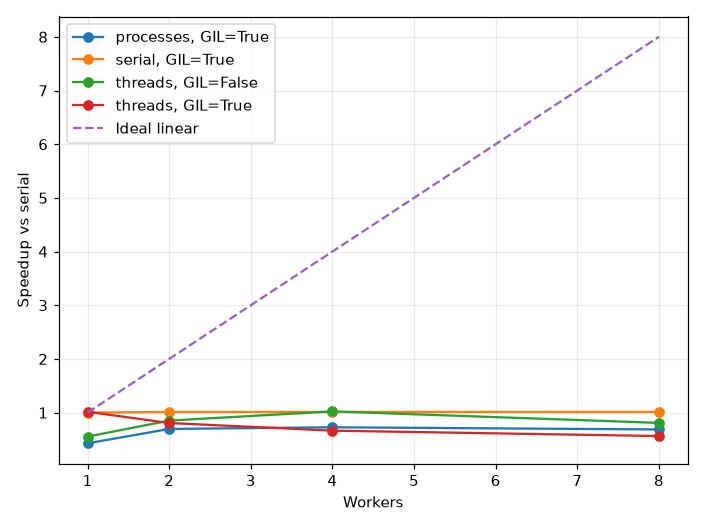

# findex — Лабораторна робота №5

Студент: Аркан Арсеній Станіславович, Б-122-23-1-ТП.
Навчальна реалізація за допомогою ШІ. [Методичка](https://github.com/rmalkevy/Programming-Practice-Projects/blob/main/courses/python/lab-05-concurrency-and-the-gil.md).

[](https://github.com/8554859-cell/findex/actions/workflows/lab01.yml)

## Запуск
```sh
uv sync --locked
uv run python scripts/download_python_docs.py
uv run findex index data/python_docs --out index.bin --positions --workers 4 --executor processes
uv run findex search index.bin "python" --corpus data/python_docs
uv run pytest
uv run python scripts/benchmark_lab05.py data/python_docs
```

## Архітектура
build_partial читає лише передані шляхи, використовує локальні Counter та списки, а merge об'єднує часткові індекси у порядку діапазонів ID. Spawn створює незалежні процеси; future.result передає винятки. Послідовний режим лишається типовим до вимірювання.

## Експеримент
Три незалежні запуски кожної конфігурації; медіана wall, сума CPU часу батьківського процесу та завершених дочірніх процесів, peak RSS лише батьківського процесу, окремий час merge. Linux ru_maxrss у KiB. Python 3.13 та 3.13t використовують один корпус. Фактичний [запуск GitHub Actions](https://github.com/8554859-cell/findex/actions/runs/45451280433): AMD EPYC 9V45, 4 доступні логічні CPU (os.cpu_count()=4, тому значення all збігається з 4), Linux Azure, Python 3.13.18 з GIL та 3.13.18t без GIL. 11284 документи, 16 конфігурацій, 48 вимірювань. CPU включає час запуску інтерпретатора; wall вимірює побудову. Послідовний режим ігнорує кількість воркерів, його повторні рядки є контрольними. Прискорення відносно serial/1.

| Executor | GIL | Workers | Wall (s) | CPU (s) | RSS (MiB) | Merge (s) | Speedup |
|---|---|---:|---:|---:|---:|---:|---:|
| serial | on | 1 | 0.7819 | 0.8275 | 62.70 | 0.0139 | 1.000× |
| serial | on | 2 | 0.7725 | 0.8183 | 62.68 | 0.0144 | 1.012× |
| serial | on | 4 | 0.7725 | 0.8182 | 62.56 | 0.0151 | 1.012× |
| serial | on | 8 | 0.7718 | 0.8185 | 62.59 | 0.0144 | 1.013× |
| threads | on | 1 | 0.7702 | 0.8160 | 63.43 | 0.0149 | 1.015× |
| threads | on | 2 | 0.9695 | 1.1243 | 64.20 | 0.0128 | 0.806× |
| threads | on | 4 | 1.1776 | 1.6792 | 65.86 | 0.0186 | 0.664× |
| threads | on | 8 | 1.3874 | 2.1399 | 67.48 | 0.0153 | 0.564× |
| processes | on | 1 | 1.8267 | 1.9448 | 106.60 | 0.0122 | 0.428× |
| processes | on | 2 | 1.1238 | 1.9523 | 92.83 | 0.0113 | 0.696× |
| processes | on | 4 | 1.0755 | 2.8728 | 83.06 | 0.0137 | 0.727× |
| processes | on | 8 | 1.1392 | 3.3226 | 74.58 | 0.0147 | 0.686× |
| threads | off | 1 | 1.4132 | 1.4684 | 83.52 | 0.0091 | 0.553× |
| threads | off | 2 | 0.9182 | 1.4994 | 85.30 | 0.0134 | 0.852× |
| threads | off | 4 | 0.7643 | 1.9208 | 89.06 | 0.0167 | 1.023× |
| threads | off | 8 | 0.9670 | 2.6023 | 94.01 | 0.0211 | 0.809× |



39 тестів пройдено, покриття 82%, Pyright strict — 0 помилок. Потоки під GIL при 8 воркерах повільніші за serial (0.564×). Процеси з 4 воркерами швидші за процес з 1 воркером (1.70×), але повільніші за serial (0.727×); тому serial лишається типовим. Без GIL 4 потоки прискорюють власний однопотоковий режим приблизно в 1.85 раза. Відмінності компіляторів і збірок також впливають на порівняння. Докладніше: [GIL](GIL.md). Сирі вимірювання: [JSON](lab05-results.json).

Попередні лабораторні доступні за тегами lab-01 — lab-04. [Wheel Lab 4](https://github.com/8554859-cell/findex/releases/tag/v0.4.0).
