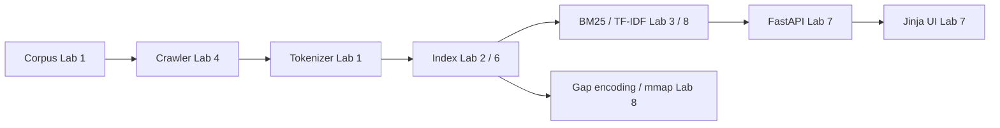

# findex — пошуковий рушій Python v1.0.0

**[Живий сайт](https://findex-9t0d.onrender.com)** · **[API](https://findex-9t0d.onrender.com/docs)** · **[Методичка Lab 8](https://github.com/rmalkevy/Programming-Practice-Projects/blob/main/courses/python/lab-08-performance-and-semantic-search.md)**

11 284 документів у локальному експерименті · 37.72× прискорення поширеного терміна · 56 тестів, 84% покриття. P95 попереднього публічного HTTP тесту — 2301 мс (Lab 7, не новий реліз).

Студент: Аркан Арсеній Станіславович, Б-122-23-1-ТП. Навчальна реалізація за допомогою ШІ.

## Архітектура



## Lab 8: вимірювання

[Перевірений CI](https://github.com/8554859-cell/findex/actions/runs/45477435361), Python 3.13, 30 повторів, медіана, прогрітий індекс.

| Запит | Збігів | Scalar, мс | NumPy, мс | Прискорення |
|---|---:|---:|---:|---:|
| the | 6124 | 12.2310 | 0.3242 | 37.72× |
| aaaaabbbbcccdde | 1 | 0.004872 | 0.040397 | 0.12× |
| python OR module OR class | 1738 | 3.9083 | 0.1684 | 23.21× |

NumPy переносить цикл скорингу в компільовані операції. Рідкісний термін повільніший через виділення масивів та виклики NumPy. Тести перевіряють ідентичність ID і близькість оцінок. Argpartition визначає top-k; однакові оцінки впорядковано за ID.

### Альтернатива семантичному пошуку

Через 512 MB RAM Render обрано поглиблену оптимізацію: окремий модуль gap encoding, стиснення NPZ і mmap. Це експеримент зі списком входжень, реплікованим 10 разів, а не новий повний корпус. Основний сервіс використовує кешовані масиви NumPy, не mmap.

| Масштаб | Віртуальні документи | Входження | Raw bytes | NPZ bytes | mmap write/open, мс | decode, мс |
|---|---:|---:|---:|---:|---:|---:|
| 1× | 11284 | 6124 | 48992 | 6869 | 1.373 | 1.137 |
| 10× | 112840 | 61240 | 489920 | 28868 | 0.954 | 1.291 |

На 10× стиснення економить 94.1% дискового простору. Декодування перевірено на точну відповідність. Час mmap включає запис і відкриття, не повне читання сторінок. Результати не є гарантією швидкодії на іншій машині.

## Профілювання

[Початкові вимірювання і гіпотези](docs/profile-baseline.md). [Реальні flame graphs та cProfile](https://github.com/8554859-cell/findex/actions/runs/45475052468/artifacts/14959316896). [Scalene та повторні flame graphs — успішний CI, артефакт lab08-profile](https://github.com/8554859-cell/findex/actions/runs/45478600825). Числовий розподіл Python/native у журналі не виведено; його слід переглянути у JSON-артефактах.

## Попередні лабораторні

- [Lab 1: код, README та вимірювання](https://github.com/8554859-cell/findex/tree/lab-01)
- [Lab 2: код, README та вимірювання](https://github.com/8554859-cell/findex/tree/lab-02)
- [Lab 3: код, README та вимірювання](https://github.com/8554859-cell/findex/tree/lab-03)
- [Lab 4: код, README та вимірювання](https://github.com/8554859-cell/findex/tree/lab-04)
- [Lab 5: код, README та вимірювання](https://github.com/8554859-cell/findex/tree/lab-05)
- [Lab 6: код, README та вимірювання](https://github.com/8554859-cell/findex/tree/lab-06)
- [Lab 7: код, README та вимірювання](https://github.com/8554859-cell/findex/tree/lab-07)

## Обмеження і демонстрація

Не реалізовано embeddings/RRF; обрано альтернативу з методички. JSON-індекс і Python postings залишаються в пам'яті; mmap експериментальний. Публічну версію 1.0.0, /health та /search підтверджено [CI](https://github.com/8554859-cell/findex/actions/runs/45478600825). Render може засинати, а мережа впливає на latency. GIF і відео з голосом студента ще не записані. План демонстрації: відкрити сайт, пошук python OR module, відкрити документ, показати Swagger та таблиці вимірювань, пояснити повільний рідкісний запит і помилку імпорту типів.

## Запуск та результати Lab 7

## Запуск
```sh
uv sync
uv run python scripts/download_python_docs.py
uv run findex index data/python_docs --out data/index.json --positions
uv run findex serve --port 8000
```
Відкрити http://127.0.0.1:8000/ або /docs для OpenAPI.

## API
/search — q, k, scorer, page; /docs/{id}; /stats; /health (503 без індексу).
Налаштування INDEX_PATH, CORPUS_PATH, SEARCH_MODE через environment або .env. Індекс завантажується один раз на процес у lifespan. Pydantic використовується на межі API; залежності підміняються у тестах.

## Docker та розгортання
```sh
docker build -t findex .
docker run --rm -p 8000:8000 findex
```
Render Blueprint: render.yaml, Docker, healthCheckPath /health. Сервіс розгорнуто на безкоштовному Render (Oregon), Docker, 0.1 CPU, 512 MB RAM. Health check: /health. Публічний пошук та HTML перевірено через CI; запит python повернув 394 збіги. Безкоштовний інстанс може засинати. Журнали доступні в Render Dashboard.

## Експерименти
Фактичний [успішний запуск GitHub Actions](https://github.com/8554859-cell/findex/actions/runs/45473618791): 45 тестів, 82% покриття, Pyright і Ruff без помилок, Docker smoke та публічний HTTP тест успішні. Корпус — 8013 фрагментів документації Python.

### 20 одночасних запитів (ASGITransport)

| Режим | Wall, с | RPS | p50, мс | p95, мс | p99, мс |
|---|---:|---:|---:|---:|---:|
| async def | 0.1896 | 105.46 | 127.74 | 131.27 | 188.72 |
| def | 0.1836 | 108.93 | 174.12 | 180.02 | 180.64 |

### oha (HTTP, /search?q=python%20OR%20module&k=10)

| Target | Concurrency | Requests | RPS | p50, ms | p95, ms | p99, ms |
|---|---:|---:|---:|---:|---:|---:|
| local, 1 worker, async def | 50 | 300 | 169.00 | 294.561 | 399.740 | 460.862 |
| local, 1 worker, def | 50 | 300 | 115.54 | 433.065 | 470.172 | 489.698 |
| local, 4 workers, def | 50 | 300 | 215.98 | 258.380 | 316.583 | 343.391 |
| Render, def | 20 | 100 | 12.05 | 1702.267 | 2301.035 | 2394.100 |

Усі 1000 запитів успішні. Сирий JSON публічного тесту — артефакт lab07-public-oha у зазначеному CI. Чотири процеси дали 1.87× RPS відносно одного sync-воркера. Async варіант швидший за sync в локальному HTTP тесті, але синхронні обчислення та читання файлів усередині async def блокують event loop. Тому залишено def: це захищає чутливість інших маршрутів, хоча thread pool додає витрати і не усуває GIL. Render має інші ресурси та мережеву затримку, тому його RPS не можна прямо порівнювати з локальним.  CPU-пошук у async def може заблокувати event loop; sync def переносить його в thread pool, але GIL обмежує CPU-паралельність. Кілька воркерів — окремі процеси з власним індексом, що збільшує використання пам'яті.
